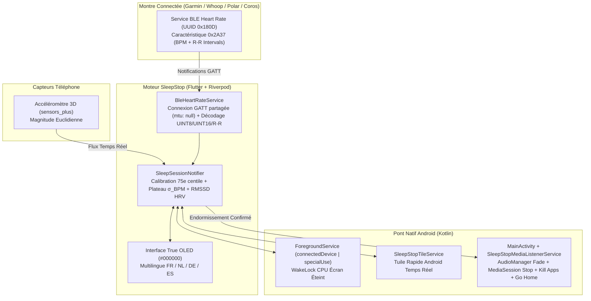

<div align="center">


# SleepStop

### **Smart Biometric & Motion Media Sleep Stopper for Android**
*Arrête automatiquement tes livres audio, podcasts et vidéos à la seconde exacte où tu t'endors.*

[-3DDC84?logo=android&logoColor=white)](https://developer.android.com)
[](https://flutter.dev)
[](https://kotlinlang.org)
[](#montres--capteurs-compatibles)
[](#multilingue-fr--nl--de--es)
[](https://sleepstop.eu)

</div>

---

## Pourquoi SleepStop ?

Les minuteurs de sommeil classiques (*"Arrêter dans 30 minutes"*) ont deux défauts majeurs :
1. **Tu t'endors en 9 minutes** : ton livre audio *Audible*, ton podcast *Spotify* ou ta vidéo *YouTube* continue de tourner pendant 21 minutes dans le vide — et au réveil, tu es complètement perdu dans l'histoire.
2. **Tu mets 35 minutes à t'endormir** : le son se coupe brutalement alors que tu as encore les yeux grands ouverts, t'obligeant à rallumer ton écran et casser ton endormissement.

**SleepStop** résout ce problème en reliant directement les **signaux biométriques de ta montre connectée** (ou les micro-mouvements de ton téléphone) au **contrôleur média natif d'Android**. Dès que ta physiologie confirme que tu viens de basculer dans le sommeil, SleepStop baisse progressivement le volume, met en pause ton média, ferme les applications choisies et note l'heure ainsi que le chapitre exact où tu t'es arrêté.

---

## Fonctionnalités Clés

### 1. Moteur Biométrique Adaptatif (Inspiré de Firstbeat / Garmin)
Plutôt que d'utiliser un seuil fixe arbitraire (car un sportif au repos à `46 BPM` et une personne à `74 BPM` après un repas ont des profils totalement différents), SleepStop intègre un algorithme **Smart Adaptive** :
- **Calibration automatique au coucher (90s)** : calcule le 75e centile de ta fréquence cardiaque éveillée au lit (en ignorant les pics liés aux mouvements).
- **Courbe de chute adaptative** : ajuste dynamiquement la cible d'endormissement selon que ton pouls de départ est déjà bas (`-4 BPM` suffisent) ou élevé (`-12 %`).
- **Stabilité du plateau cardiaque ($\sigma_{\text{BPM}}$)** : vérifie l'écart-type glissant sur 60 secondes ($\sigma \le 1.8\text{ BPM}$) caractéristique de l'entrée en sommeil léger **N1/N2**.
- **Analyse VFC / HRV (Intervalles R-R `0x2A37`)** : décode les intervalles R-R en résolution `1/1024s` et calcule le **RMSSD** en temps réel pour détecter l'activation parasympathique.
- **Auto-apprentissage nocturne** : mémorise ton pouls réel d'endormissement nuit après nuit ($70\%\text{ historique} + 30\%\text{ nouvelle nuit}$).

### 2. Mode Sans Montre : « Smart Fade & Shake » (Dead Man's Switch)
Pas de montre chargée ce soir ? Le mode **Téléphone uniquement** lance un cycle intelligent :
- Toutes les $X$ minutes (configurable de 5 à 60 min), SleepStop amorce un **fondu sonore ultra-doux de 60 secondes**.
- **Encore éveillé ?** Bouge ou tapote simplement ton téléphone posé sur le matelas : l'accéléromètre 3D ($\|\vec{a}\| = \sqrt{x^2 + y^2 + z^2}$) détecte le mouvement, remonte instantanément le volume et relance le compteur.
- **Endormi ?** Au bout des 60 secondes de fondu, le média est mis en pause, le volume initial est restauré silencieusement pour le lendemain matin, et **l'heure d'endormissement enregistrée est celle du début du fondu**.

### 3. Fermeture Forcée des Applications & Extinction d'Écran Vidéo
- Sélectionne les applications de ton téléphone à couper à l'endormissement (**Audible, YouTube, Spotify, Netflix, Twitch, TikTok, Deezer, VLC...**).
- **Sortie automatique du plein écran vidéo** : lorsque tu t'endors devant *YouTube*, *Netflix* ou *Twitch*, SleepStop coupe le flux média, ramène Android sur l'écran d'accueil pour libérer le *wake-lock* vidéo (permettant à ton écran de s'éteindre tout seul) et tue les processus en arrière-plan (`killBackgroundProcesses`).

### 4. Journal de Sommeil, Signet Intelligent & Courbe BPM
Chaque matin, retrouve dans l'onglet **Historique** :
- **La durée réelle d'écoute éveillée** (ex. `18 min`) et un bouton **Rewind** rapide.
- **Le nom de l'application fermée et le titre exact du chapitre / de la vidéo** en cours au moment où tu t'es endormi (via `SleepStopMediaListenerService`).
- **La courbe biométrique (Sparkline BPM)** traçant la descente de ton rythme cardiaque jusqu'au sommeil.

### 5. Tuile de Lancement Rapide Android (Quick Settings Tile)
- Intègre un `TileService` Android natif (`SleepStopTileService`).
- Permet d'activer ou d'arrêter SleepStop **en 1 clic depuis le volet de notifications Android** sans même quitter YouTube ou Audible, avec affichage du pouls en direct sur la tuile (`Actif • 56 BPM`).
- Bouton d'installation en 1 clic dans l'application via l'API Android 13+ `StatusBarManager.requestAddTileService`.

---

## Architecture Technique



---

## Montres & Capteurs Compatibles

SleepStop utilise le standard officiel **Bluetooth SIG Heart Rate Service (`0x180D`)** et intègre une gestion spécifique du lien GATT partagé sur Android pour fonctionner **en parallèle de Garmin Connect** sans déconnecter la montre :

| Marque | Modèles Compatibles | Comment activer la diffusion ? |
| :--- | :--- | :--- |
| **Garmin** | Fenix 6/7/8, Epix, Forerunner, Venu, Vivoactive, Instinct | *Paramètres > Capteurs et accessoires > Fréquence cardiaque au poignet > **Diffuser la FC*** (astuce : associe-le à un raccourci bouton !) |
| **Whoop** | Whoop 4.0, Whoop 5.0 | Ouvrir l'app Whoop > *Paramètres de l'appareil > **Diffusion de la fréquence cardiaque (Broadcast HR)*** |
| **Polar & Wahoo** | Polar H10, H9, Verity Sense, OH1, Wahoo Tickr | Diffusion native automatique dès que le capteur est porté |
| **Coros** | Pace 2/3, Apex, Vertix | Maintenir le bouton Retour > *Boîte à outils > **Diffuser la FC*** |
| **Xiaomi / Amazfit** | Balance, GTR/GTS, T-Rex, Mi Band | Application *Zepp > Profil > Montre > **Partage de fréquence cardiaque*** |
| **Wear OS** | Samsung Galaxy Watch 4/5/6/7/Ultra, Pixel Watch | Via l'application compagnon *Heart Rate to BLE* sur la montre |

---

## Multilingue (FR / NL / DE / ES)

L'application intègre un dictionnaire réactif instantané ([`lib/l10n/app_strings.dart`](lib/l10n/app_strings.dart)) permettant de basculer à chaud en 1 clic entre :
- 🇫🇷 **Français (FR)**
- 🇳🇱 **Nederlands (NL)**
- 🇩🇪 **Deutsch (DE)**
- 🇪🇸 **Español (ES)**

---

## Structure du Projet

```text
├── android/app/src/main/
│   ├── AndroidManifest.xml                  # Permissions BLE, ForegroundService, NotificationListener & Quick Tile
│   └── kotlin/com/sleepstop/sleep_stop/
│       ├── MainActivity.kt                  # MethodChannel : Volume, MediaKey, Kill Apps, Permissions, Quick Tile
│       ├── SleepStopMediaListenerService.kt # Inspection du titre média & application active (MediaSessionManager)
│       └── SleepStopTileService.kt          # Tuile de lancement rapide Android (TileService)
├── assets/icon/
│   ├── app_icon.png                         # Logo in-app
│   └── play_store_512.png                   # Icône haute résolution 512x512 pour Google Play Console
├── lib/
│   ├── l10n/app_strings.dart                # Traductions FR, NL, DE, ES
│   ├── models/                              # Modèles immuables (SleepSettings, SleepSessionLog, ActiveSessionState)
│   ├── providers/                           # Logique Riverpod & Algorithme biométrique adaptatif
│   ├── services/                            # Services BLE 0x180D, Accéléromètre 3D, MediaControl, Notifications
│   └── ui/                                  # Interface True OLED Black (#000000), Guide Montres, Sélecteur d'Apps, Pro
└── test/
    └── widget_test.dart                     # Tests unitaires (décodage binaire BLE 0x2A37, R-R, Accéléromètre, Responsive UI)
```

---

## Compilation & Installation

### Prérequis
- **Flutter SDK** `^3.11.0`
- **Android SDK** (API 26 à API 36)

### Commandes rapides
```bash
# 1. Installer les dépendances
flutter pub get

# 2. Vérifier l'analyse statique et lancer les tests unitaires
flutter analyze
flutter test

# 3. Compiler l'APK Debug ou le Bundle Release Google Play (.aab)
flutter build apk --debug
flutter build appbundle --release
```

---

## Confidentialité & Sécurité (RGPD)

- **100 % Local & Hors-ligne** : Toutes les mesures de fréquence cardiaque, intervalles R-R et historiques de sommeil sont traités exclusivement en mémoire locale sur ton téléphone (`SharedPreferences`).
- **Zéro collecte cloud** : Aucune donnée biométrique ou personnelle n'est transmise à un serveur externe.

---

<div align="center">
  <sub>Conçu et développé avec soin par <b>Ludovic</b> • <a href="https://sleepstop.eu">sleepstop.eu</a></sub>
</div>
